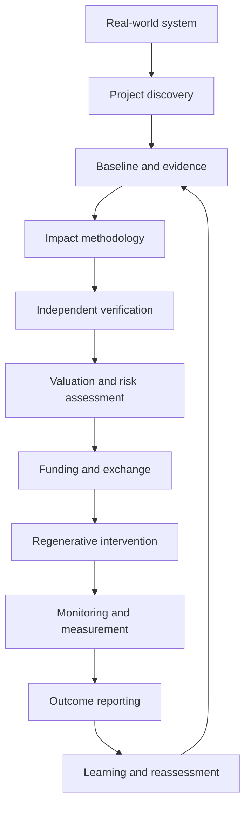
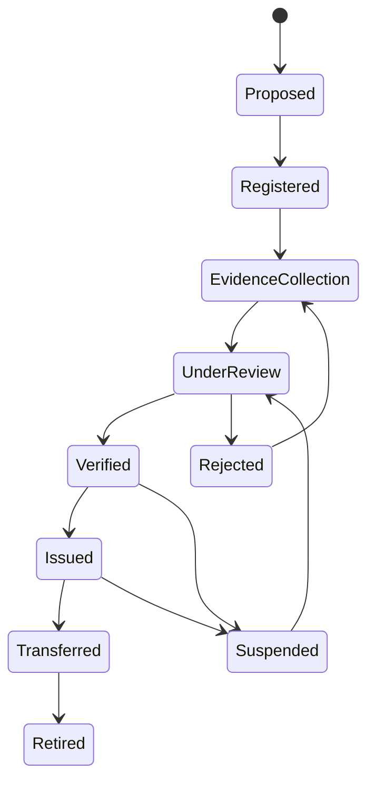
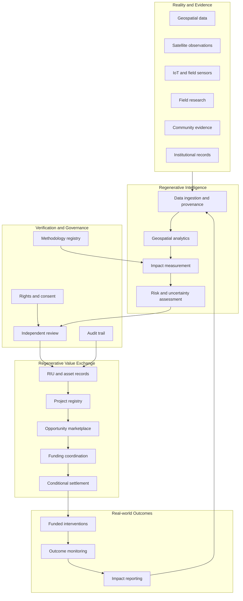
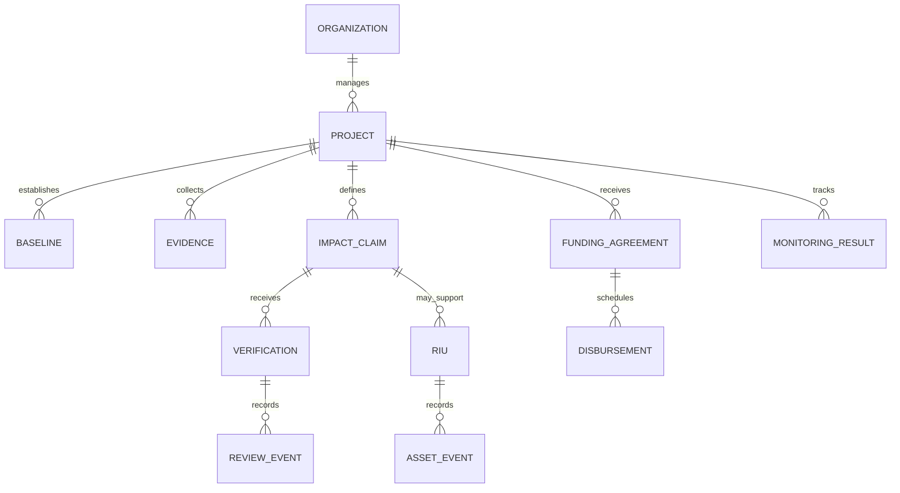

# Regenerative Value Exchange (RVE)

### An Atlas Sanctum Initiative

**Turning ecological restoration, community stewardship, and regenerative development into measurable, verifiable, and fairly distributed value.**

**Regenerative Value Exchange (RVE)** is a proposed platform for discovering, measuring, verifying, financing, and exchanging regenerative value across ecological systems, communities, institutions, and markets.

Built within the vision of [Atlas Sanctum](https://atlassanctum.me), RVE seeks to bridge the gap between the value created by regeneration and the institutions, evidence, and economic mechanisms required to recognize it.

The platform combines geospatial intelligence, impact measurement, evidence provenance, community participation, verification workflows, and programmable value exchange.

Its purpose is not simply to create another marketplace or token. It is to develop trustworthy infrastructure for coordinating capital and action around measurable improvements in the real world.

> **Our doctrine:** Reality before claims. Evidence before valuation. Verification before settlement. Stewardship before extraction. Measurable impact before declarations of success.

---

## Table of Contents

- [1. The Problem](#1-the-problem)
- [2. The Vision](#2-the-vision)
- [3. Mission and Objectives](#3-mission-and-objectives)
- [4. Core Principles](#4-core-principles)
- [5. The RVE Operating Model](#5-the-rve-operating-model)
- [6. Regenerative Intelligence Units](#6-regenerative-intelligence-units-rius)
- [7. Platform Architecture](#7-platform-architecture)
- [8. Regenerative Asset Categories](#8-regenerative-asset-categories)
- [9. Impact Verification Framework](#9-impact-verification-framework)
- [10. Marketplace and Value Distribution](#10-marketplace-and-value-distribution)
- [11. AI and Geospatial Intelligence](#11-ai-and-geospatial-intelligence)
- [12. Community and Institutional Participation](#12-community-and-institutional-participation)
- [13. Technical Architecture](#13-technical-architecture)
- [14. Data Model](#14-data-model)
- [15. API Design](#15-api-design)
- [16. Security, Governance and Integrity](#16-security-governance-and-integrity)
- [17. MVP Roadmap](#17-mvp-roadmap)
- [18. Success Metrics](#18-success-metrics)
- [19. Research Agenda](#19-research-agenda)
- [20. Contributing](#20-contributing)
- [21. Responsible Use and Disclaimers](#21-responsible-use-and-disclaimers)
- [22. The Long-Term Vision](#22-the-long-term-vision)

---

## 1. The Problem

Regenerative projects create value that conventional economic systems often struggle to measure, verify, finance, or distribute fairly.

Examples include restoring degraded land, protecting watersheds, improving soil health, strengthening climate resilience, preserving cultural landscapes, and building community infrastructure.

Yet several structural challenges persist.

| Challenge | Consequence | RVE response |
|---|---|---|
| Fragmented environmental data | Incomplete understanding of real-world conditions | Geospatial and evidence integration |
| Inconsistent impact methodologies | Results that cannot be reliably compared | Explicit metrics and documented methods |
| Weak verification | Greenwashing, disputed claims, and unreliable credits | Evidence provenance and independent review |
| Limited access to capital | Valuable projects remain unfunded | Structured project discovery and financing workflows |
| Opaque value distribution | Communities may receive little of the value they create | Transparent benefit-sharing rules |
| Fragmented project coordination | Funders, researchers, implementers, and communities work in isolation | Shared project and opportunity infrastructure |
| Uncertain long-term outcomes | Initial claims may not reflect sustained results | Monitoring, reassessment, and reversal tracking |

RVE addresses these problems by connecting **real-world conditions, credible evidence, accountable decisions, capital allocation, and measurable outcomes**.

## 2. The Vision

A world where regenerative value can be identified, understood, verified, financed, and fairly shared.

RVE envisions an economy in which ecological and social improvements become legible to institutions without reducing nature, culture, or human dignity to a single financial metric.

The platform is designed to support a connected cycle:

**Observe → Understand → Validate → Value → Finance → Act → Measure → Learn**

Each stage produces evidence and accountability for the next.

The long-term ambition is to establish a trusted exchange layer connecting:

- Land stewards and restoration organizations.
- Farmers, cooperatives, and local communities.
- Researchers and independent verification bodies.
- Governments and public institutions.
- Climate and conservation organizations.
- Impact investors, foundations, and development finance institutions.
- Technology providers and environmental data platforms.
- Buyers and funders seeking credible, measurable outcomes.

## 3. Mission and Objectives

### Mission

Build trustworthy digital infrastructure that helps society recognize, finance, and distribute the value created through regeneration.

### Strategic objectives

1. **Make regeneration observable.** Connect projects to geospatial, environmental, economic, and community evidence.
2. **Make claims verifiable.** Establish transparent methodologies, evidence provenance, and independent review.
3. **Make projects investable.** Structure project information, funding needs, expected outcomes, risks, and monitoring plans.
4. **Make value exchange accountable.** Record ownership, permissions, transactions, and benefit-sharing obligations.
5. **Make impact measurable over time.** Track baselines, interventions, outcomes, uncertainty, and reversals.
6. **Make participation inclusive.** Reduce barriers for community organizations and smaller projects.
7. **Make intelligence reusable.** Develop open interfaces and interoperable data models for researchers and institutions.

## 4. Core Principles

### 4.1 Reality before representation

A digital record is not proof that an environmental or social improvement occurred. Every important claim must have an appropriate evidence trail.

### 4.2 Evidence before valuation

An asset should not receive a credible impact-based valuation merely because a project owner has listed it.

### 4.3 Verification before settlement

Where payment depends on verified outcomes, settlement must follow the agreed verification process and dispute rules.

### 4.4 Regeneration before extraction

The platform should incentivize lasting ecological and social improvements rather than short-term claims or the displacement of harm elsewhere.

### 4.5 Fairness in value distribution

Communities, land stewards, project operators, verifiers, and capital providers should have transparent roles, rights, obligations, and compensation arrangements.

### 4.6 Uncertainty must remain visible

Measurements and models have limitations. The platform should preserve confidence ranges, missing data, assumptions, and methodological caveats.

### 4.7 Interoperability over lock-in

Projects and institutions should be able to export their data, evidence, and transaction histories in documented formats, subject to privacy and contractual restrictions.

### 4.8 Technology serves stewardship

AI, blockchain, smart contracts, and financial mechanisms are tools. None substitutes for sound science, accountable governance, or legitimate community consent.

## 5. The RVE Operating Model

RVE connects the entire lifecycle of regenerative value.

### The operating sequence

1. **Discover:** Identify a place, challenge, community need, or regenerative opportunity.
2. **Register:** Define the project, responsible parties, location, objectives, rights, and governance.
3. **Establish a baseline:** Record the initial conditions and select relevant indicators.
4. **Design measurement:** Document methodologies, data sources, monitoring frequency, and uncertainty.
5. **Collect evidence:** Gather field observations, remote-sensing products, records, and community reports.
6. **Verify:** Subject claims to risk-appropriate independent review.
7. **Assess value:** Estimate outcomes, costs, risks, additionality, permanence, and distributional effects.
8. **Coordinate capital:** Connect suitable funding sources to qualified projects and milestones.
9. **Execute:** Deliver the funded intervention and record expenditure and implementation evidence.
10. **Monitor:** Evaluate outcomes against baselines and agreed targets.
11. **Reconcile:** Adjust records for corrections, reversals, disputes, or newly available evidence.
12. **Learn:** Improve methodologies, project selection, and future decisions.

Not every project requires every stage. The workflow should be configurable to the asset class, risk level, applicable standards, and transaction structure.

## 6. Regenerative Intelligence Units (RIUs)

### Concept

A Regenerative Intelligence Unit (RIU) is a proposed digital record for organizing evidence, measurement, provenance, verification status, and accountable claims about a defined regenerative outcome or asset.

RIUs are intended to connect a real-world project to the information needed to assess its credibility and potential value.

**An RIU is not automatically a carbon credit, financial security, currency, ownership right, or legally transferable environmental attribute.** Those properties would require explicit definitions, appropriate legal arrangements, and any applicable regulatory approvals.

### What an RIU may represent

Depending on the project and governing methodology, an RIU could be associated with:

- Verified restoration outcomes.
- Quantified greenhouse-gas reductions or removals.
- Watershed or water-quality improvements.
- Biodiversity indicators.
- Soil-health improvements.
- Climate adaptation and resilience outcomes.
- Community infrastructure outcomes.
- Cultural landscape stewardship.
- Other clearly defined and measurable public-benefit outcomes.

These categories are not interchangeable. Each requires its own measurement method, accounting rules, and safeguards.

### RIU record structure

An RIU record should include:

| Field | Description |
|---|---|
| `riu_id` | Unique identifier |
| `project_id` | Associated project |
| `asset_type` | Defined category of regenerative value |
| `claim` | Precisely stated outcome or attribute |
| `geographic_scope` | Location or area of applicability |
| `baseline_reference` | Baseline dataset and methodology |
| `measurement_period` | Period covered by the claim |
| `quantity` | Measured quantity and unit, where applicable |
| `methodology_version` | Rules used to calculate the result |
| `evidence_references` | Links or identifiers for supporting evidence |
| `verification_status` | Draft, submitted, verified, rejected, or under review |
| `uncertainty` | Applicable measurement uncertainty |
| `rights_and_claims` | Relevant ownership, permissions, and claim restrictions |
| `issuance_status` | Whether an authorized issuance has occurred |
| `retirement_status` | Whether a claim has been retired or otherwise consumed |
| `revision_history` | Corrections and previous versions |

### RIU lifecycle

This lifecycle is a proposed model. Actual issuance, transfer, suspension, and retirement permissions must be governed by the relevant asset methodology and legal framework.

A verified impact record should remain distinguishable from a transferable unit representing a specific contractual or environmental claim.

## 7. Platform Architecture

RVE is intended to operate as part of the broader Atlas Sanctum ecosystem.

### Major platform components

**Reality Intelligence Layer**

Integrates observations about places, ecosystems, infrastructure, and communities.

**Regenerative Measurement Layer**

Converts raw evidence into documented indicators, estimates, and outcome assessments.

**Verification and Trust Layer**

Manages methodology versions, reviewer decisions, evidence provenance, permissions, and audit history.

**Asset Registry**

Maintains project and RIU records, their status, applicable rights, and associated evidence.

**Opportunity Exchange**

Matches qualified regenerative projects with funders, implementation partners, researchers, and service providers.

**Capital Coordination Layer**

Coordinates funding commitments, milestones, escrow arrangements where appropriate, and financial reconciliation.

**Monitoring and Learning Layer**

Tracks outcomes after intervention and feeds updated observations back into assessment and decision-making.

## 8. Regenerative Asset Categories

RVE should support a modular methodology registry instead of applying one universal scoring system to every type of value.

### Environmental assets

- **Carbon:** Quantified emissions reductions and removals, where methodologies support credible accounting.
- **Biodiversity:** Defined habitat, species, ecosystem-condition, or conservation outcomes.
- **Water:** Water quality, availability, watershed restoration, and other locally appropriate indicators.
- **Soil:** Soil organic carbon, erosion, fertility, and land-condition indicators.
- **Restoration:** Restoration area, ecological condition, survival rates, and recovery trajectories.
- **Climate resilience:** Measured changes in exposure, vulnerability, preparedness, or adaptive capacity.

### Community and development outcomes

- Access to essential infrastructure.
- Water and sanitation improvements.
- Food-system resilience.
- Livelihoods and local economic participation.
- Community-led restoration.
- Cultural landscape preservation.
- Institutional capacity and locally defined development outcomes.

Social outcomes must not be represented as environmental credits without a valid methodology. Community consent, privacy, and safeguards against exploitative claims are essential.

### Minimum asset qualification

Before an asset can be represented as verified, the system should establish:

1. A clearly defined claim and unit of measurement.
2. A relevant baseline or defensible reference condition.
3. A documented methodology.
4. Appropriate supporting evidence.
5. A valid project mandate and applicable rights.
6. A defined verification procedure.
7. A policy for duplicate claims and double counting.
8. Monitoring and correction procedures.
9. Transparent limitations and uncertainty.
10. Applicable consent, legal, and safeguarding requirements.

## 9. Impact Verification Framework

Verification is the foundation of RVE's credibility.

The platform should distinguish five separate concepts:

- **Observation:** Something was recorded.
- **Measurement:** An indicator was calculated using a stated method.
- **Verification:** An authorized reviewer assessed a claim against defined criteria.
- **Valuation:** A financial or decision-oriented assessment was made.
- **Settlement:** A contractual payment or transfer was executed.

One does not automatically establish the others.

### Evidence hierarchy

Evidence quality depends on the claim, not simply on the technology used to collect it.

| Evidence type | Potential contribution | Important limitation |
|---|---|---|
| Satellite imagery | Land-cover and landscape change | Resolution, classification errors, and causal ambiguity |
| Field measurements | Direct observations and samples | Sampling bias and measurement error |
| Sensors and IoT | Continuous environmental observations | Calibration, availability, and tampering |
| Research studies | Scientific context and tested methods | May not generalize to a particular location |
| Administrative records | Project activities and expenditure | May not establish ecological outcomes |
| Community observations | Local knowledge and ground-level context | Requires appropriate validation and consent |
| Independent audits | Review against stated criteria | Scope and independence must be assessed |

### Verification dimensions

A configurable verification framework should evaluate:

- Evidence completeness.
- Methodological validity.
- Measurement uncertainty.
- Baseline quality.
- Additionality, where relevant.
- Permanence and reversal risk, where relevant.
- Leakage and displaced impacts, where relevant.
- Duplicate issuance or claims.
- Rights and authorization.
- Distributional effects.
- Independent reviewer findings.

Not all dimensions apply equally to all asset types.

### Verification record

Every material decision should record:

- Claim identifier.
- Evidence set and provenance.
- Methodology and version.
- Reviewer identity or authorized reviewer identifier.
- Review date and decision.
- Unresolved issues.
- Confidence or uncertainty assessment.
- Conditions and limitations.
- Appeal or dispute outcome, where applicable.

AI may assist with anomaly detection, evidence organization, and risk prioritization. It must not silently replace required independent verification.

## 10. Marketplace and Value Distribution

RVE is intended to coordinate exchanges between project owners, stewards, funders, buyers, and implementation partners.

### Core marketplace functions

- Discover projects and regenerative opportunities.
- Compare methodologies and evidence quality.
- Assess project readiness and implementation risk.
- Review funding needs, milestones, and expected outcomes.
- Submit expressions of interest or funding proposals.
- Structure conditional commitments and milestone-based disbursements.
- Track contractual obligations and reporting.
- Record completed transactions and applicable asset transfers.
- Monitor outcomes after funding.
- Publish appropriate impact reports.

### Potential transaction types

- Grants and philanthropic funding.
- Outcome-based contracts.
- Restoration project financing.
- Payments for ecosystem services.
- Research and monitoring contracts.
- Institutional procurement.
- Eligible environmental asset transactions.
- Community benefit-sharing agreements.

Each transaction type requires its own contract, accounting treatment, permissions, and compliance review.

### Fair value distribution

Where project revenue or funding is shared, the distribution mechanism should be documented before execution.

Possible beneficiaries include:

- Local communities and land stewards.
- Project implementers.
- Monitoring and verification providers.
- Maintenance and restoration funds.
- Technology and operational providers.
- Capital providers, according to agreed terms.

The platform should make applicable fees, payment conditions, deductions, and benefit-sharing obligations visible to authorized participants.

**RVE should not treat financial return as the sole measure of success.** Ecological integrity, community rights, distributional fairness, and long-term outcomes must remain explicit decision criteria.

## 11. AI and Geospatial Intelligence

RVE can use AI to reduce the cost of interpreting environmental evidence and improve the quality of regenerative decisions.

### Potential capabilities

**Geospatial change detection**

Identify changes in land cover, vegetation, water extent, or other observable landscape features.

**Project risk assessment**

Identify data gaps, implementation risks, overlapping claims, and indicators requiring closer review.

**Evidence intelligence**

Organize documents, research findings, monitoring reports, and field observations into traceable evidence collections.

**Anomaly detection**

Flag inconsistent measurements, unexpected changes, and potentially duplicated or manipulated records.

**Outcome forecasting**

Estimate plausible future trajectories under explicit assumptions, with uncertainty ranges.

**Opportunity matching**

Match projects with relevant funders, technical experts, research institutions, and implementation partners.

**Natural-language research**

Help users query project evidence, compare methodologies, and generate structured reports with source references.

### AI integrity requirements

- Maintain traceability from model outputs to source evidence.
- Distinguish observed data from predictions and assumptions.
- Record relevant model and methodology versions.
- Evaluate performance across geography, season, and environmental conditions.
- Preserve human review for consequential decisions.
- Communicate uncertainty rather than presenting estimates as facts.
- Avoid using AI-generated summaries as substitutes for primary evidence.

## 12. Community and Institutional Participation

RVE should be designed around the needs of participants with different resources, responsibilities, and levels of technical capacity.

| Participant | Platform capability |
|---|---|
| Communities and land stewards | Register initiatives, contribute evidence, review permissions, and track benefits |
| Project developers | Manage projects, baselines, monitoring, and funding requests |
| Researchers | Develop methodologies, evaluate results, and publish reproducible evidence |
| Independent verifiers | Review claims, record findings, and identify deficiencies |
| Governments and counties | Coordinate place-based projects and review authorized reporting |
| Funders | Assess opportunities, establish conditions, and monitor milestones |
| Buyers | Review eligible assets, documentation, and contractual claims |
| Developers | Integrate through APIs and reusable data models |

### Kenya-first implementation principle

A practical starting point is a small number of well-defined projects in Kenya, with expansion determined by evidence and institutional demand.

Potential pilot themes include:

- Watershed and water-resource restoration.
- Rural land restoration and soil health.
- Climate-resilient agriculture.
- Reforestation and ecosystem recovery.
- County-level environmental monitoring.
- Community infrastructure and resilience.

The pilot selection should prioritize measurable outcomes, legitimate local partners, accessible evidence, and a realistic route to sustained funding.

## 13. Technical Architecture

The technical stack should remain modular. The first implementation should prioritize evidence integrity, reliable data management, and a working project workflow over premature blockchain or token infrastructure.

### Proposed stack

| Layer | Candidate technologies | Purpose |
|---|---|---|
| Web application | React, TypeScript, Vite | Project and marketplace interface |
| API | TypeScript with Node.js or a suitable backend framework | Application services |
| Database | PostgreSQL with PostGIS | Relational data and geospatial records |
| Authentication | Supabase Auth or an equivalent provider | Identity and access |
| Evidence storage | S3-compatible object storage | Documents, imagery, and evidence artifacts |
| Geospatial processing | Python, GeoPandas, Rasterio, GDAL | Spatial analysis and data processing |
| Analytics | Python, scikit-learn, and suitable geospatial ML tools | Statistical analysis and modeling |
| Background jobs | A task queue or managed job service | Ingestion, processing, and scheduled monitoring |
| Audit integrity | Append-only event records and cryptographic hashes | Tamper-evident evidence history |
| Blockchain | Optional, subject to a demonstrated requirement | Shared state or settlement across independent parties |
| Payments | A compliant payment provider suited to the jurisdiction | Authorized financial transactions |
| Observability | Structured logs, metrics, tracing, and alerts | Reliability and incident response |
| Testing | Unit, integration, API, and end-to-end tests | Correctness and regression prevention |

These are candidate technologies, not claims about the current repository's implementation.

### Architectural principles

1. Use PostgreSQL and PostGIS as the initial source of structured project and spatial records.
2. Store large evidence artifacts separately, with checksums and versioned metadata.
3. Use explicit application permissions and role-based access controls.
4. Maintain auditable transitions for verification and asset lifecycle events.
5. Design asynchronous processing for large imagery and analytics workloads.
6. Expose versioned APIs with clear authorization boundaries.
7. Make critical operations idempotent and resilient to retries.
8. Introduce blockchain only when a specific trust, governance, or settlement requirement justifies its cost and complexity.

### Blockchain decision rule

A blockchain may be useful when multiple independent organizations need a shared transaction history that no single participant should unilaterally control.

It does not establish whether a physical-world claim is true.

For the initial MVP, a well-designed database, immutable event history, controlled access, signed verification records, and independent audits may be sufficient.

## 14. Data Model

The core relational model should connect projects, claims, evidence, verification, and financial activity without conflating them.

### Proposed core entities

**Organization**

Identity, registration information, permissions, and organizational relationships.

**Project**

Project purpose, geography, responsible parties, methodology, status, and monitoring plan.

**Baseline**

Reference conditions, measurement date, data sources, assumptions, and methodology version.

**Evidence**

Artifact reference, provenance, collection time, checksum, access permissions, and metadata.

**ImpactClaim**

Claim definition, metric, unit, scope, measurement period, calculation method, and uncertainty.

**Verification**

Reviewer, scope, findings, decision, limitations, and review timestamp.

**RIU**

An identifier and lifecycle record linking a defined claim to its evidence and applicable rights.

**FundingAgreement**

Parties, amount, currency, conditions, milestones, reporting obligations, and contractual status.

**Disbursement**

Payment reference, amount, scheduled milestone, execution status, and reconciliation record.

**MonitoringResult**

Observed outcomes, measurement method, date, uncertainty, and comparison with the baseline.

**AssetEvent**

A traceable event such as issuance, transfer, suspension, correction, or retirement, where permitted.

### Data integrity requirements

- Stable identifiers for all important entities.
- Foreign-key and validation constraints.
- UTC timestamps and explicit measurement periods.
- Versioned methodologies and claim revisions.
- Checksums for stored evidence artifacts.
- Clear separation of public and restricted data.
- Explicit units and spatial reference systems.
- Audit records for consequential changes.
- Idempotency controls for transactions.
- Correction mechanisms that preserve history instead of erasing it.

## 15. API Design

A future REST API may expose the following resource groups.

| Endpoint | Purpose |
|---|---|
| `GET /api/v1/projects` | Discover projects |
| `POST /api/v1/projects` | Register a project |
| `GET /api/v1/projects/{id}` | Retrieve authorized project details |
| `POST /api/v1/projects/{id}/evidence` | Register an evidence artifact |
| `GET /api/v1/projects/{id}/claims` | Retrieve impact claims |
| `POST /api/v1/claims` | Submit a claim for assessment |
| `POST /api/v1/claims/{id}/verification` | Initiate or record an authorized verification workflow |
| `GET /api/v1/rius/{id}` | Retrieve an RIU record |
| `GET /api/v1/opportunities` | Discover funding and implementation opportunities |
| `POST /api/v1/funding-agreements` | Propose a funding agreement |
| `GET /api/v1/projects/{id}/monitoring` | Retrieve authorized monitoring results |
| `GET /api/v1/methodologies` | Browse methodology definitions |

These endpoints describe a proposed contract, not an assertion that the routes already exist.

### API standards

- Version all public APIs.
- Validate request payloads against explicit schemas.
- Enforce authorization at the resource and action level.
- Apply rate limits and abuse protection.
- Document error responses and pagination.
- Record audit events for consequential operations.
- Use signed webhooks where external event delivery is required.
- Never expose private community information or confidential evidence by default.

## 16. Security, Governance and Integrity

RVE's credibility depends on institutional design as much as technical design.

### Security requirements

- Secure authentication and authorization.
- Least-privilege service and database permissions.
- Encryption in transit and appropriate encryption at rest.
- Secure handling of credentials and API keys.
- Input validation and protection against common application vulnerabilities.
- Auditable privileged actions.
- Backup, restoration, and incident-response procedures.
- Independent security review before handling significant funds or sensitive information.

### Governance requirements

- Clear methodology ownership and revision procedures.
- Separation of project ownership from independent verification.
- Conflict-of-interest declarations.
- Documented disputes, appeals, and corrections.
- Transparent rules for suspending or invalidating claims.
- Community consent and appropriate data rights.
- Public disclosure of relevant fees and conflicts.
- Clear responsibility for monitoring and remediation.

### Preventing greenwashing and double counting

The platform should distinguish between:

- A project activity and an achieved outcome.
- An estimated result and a verified result.
- A verified result and an issued environmental credit.
- An issued credit and a credit retired against a specific claim.
- A project's contribution to an outcome and ownership of the associated claim.
- A funding contribution and an exclusive environmental attribute.

Where claims overlap, the platform must apply asset-specific accounting rules and preserve a record of relevant rights, transfers, retirements, and corrections.

## 17. MVP Roadmap

The first release should demonstrate one complete regenerative project lifecycle before attempting to support every asset class or financial mechanism.

### Phase 1 — Evidence-backed project registry

**Objective:** Create a reliable source of structured project information.

Deliverables:

- Project registration and editing.
- Organization and user permissions.
- Project geography and map interface.
- Baseline and methodology records.
- Evidence uploads with provenance metadata.
- Project status and audit history.
- Basic project discovery.

Acceptance criteria:

- An authorized user can register and update a project.
- Every project has a stable identifier and defined ownership or responsibility.
- Evidence artifacts have recorded provenance and integrity checks.
- Access controls prevent unauthorized access to restricted records.
- Project records can be exported in a documented format.

### Phase 2 — Impact claims and verification

**Objective:** Demonstrate that claims can be reviewed transparently.

Deliverables:

- A small, well-defined set of supported indicators.
- Methodology registry with versioning.
- Claim submission workflow.
- Independent reviewer assignment.
- Verification decisions and supporting findings.
- Uncertainty and data-gap reporting.
- Correction and dispute history.

Acceptance criteria:

- A reviewer can reproduce the calculation for a supported claim from recorded inputs and methodology.
- Unverified claims are visibly distinguished from verified claims.
- Changes to claims preserve an auditable history.
- Rejected claims cannot enter a verified-only workflow without an authorized resolution.

### Phase 3 — Opportunity and funding coordination

**Objective:** Connect qualified projects with institutional partners.

Deliverables:

- Opportunity listings.
- Project readiness information.
- Funding requirements and milestone plans.
- Expressions of interest.
- Funding agreement records.
- Reporting and disbursement tracking.
- Basic institutional reporting.

Acceptance criteria:

- A funder can assess a project's documented evidence and readiness.
- A project can record funding conditions and milestones.
- Payments are represented accurately as proposed, scheduled, or completed.
- Financial records reconcile with authoritative transaction references.

### Phase 4 — RIU lifecycle and exchange

**Objective:** Implement a narrowly scoped, well-governed asset lifecycle.

Deliverables:

- RIU identifiers and records.
- Eligibility and issuance rules for the selected asset type.
- Authorized issuance and transfer workflows, if applicable.
- Duplicate-claim checks.
- Retirement or consumption records where required.
- Dispute, suspension, and correction mechanisms.

Acceptance criteria:

- Issuance requires all specified prerequisites.
- Unauthorized transfers and lifecycle transitions are rejected.
- Every consequential event is traceable to an authorized actor.
- Asset rights and restrictions are documented.
- Legal and regulatory reviews are complete for the intended use.

### Phase 5 — Monitoring and intelligence

**Objective:** Close the loop between funding and real-world outcomes.

Deliverables:

- Scheduled monitoring.
- Geospatial change analysis for a selected use case.
- Baseline comparisons.
- Outcome dashboards.
- Alerts for missing data and potential reversals.
- Reproducible reporting.
- Model evaluation and uncertainty reporting.

Acceptance criteria:

- Reports identify data sources, periods, methods, and limitations.
- Material changes can trigger review.
- Predictions are separated from observations.
- Performance is evaluated against appropriate reference data.

### Definition of a successful first pilot

A successful pilot demonstrates:

1. A legitimate project and accountable implementing partner.
2. A documented baseline.
3. A clearly defined outcome.
4. Traceable evidence.
5. A reproducible measurement procedure.
6. An independent review appropriate to the claim.
7. A documented funding or implementation decision.
8. Follow-up monitoring.
9. Transparent reporting of benefits, costs, limitations, and lessons.

A live token, public blockchain, or speculative market valuation is not required to establish this initial value.

## 18. Success Metrics

RVE should measure whether it improves the quality and efficiency of real-world decisions, not simply whether the platform accumulates registrations or transaction volume.

### Evidence quality

- Percentage of claims with complete evidence.
- Percentage of results reproducible from recorded inputs.
- Median time required for verification.
- Rate of material corrections after verification.
- Number of unresolved data-quality issues.
- Proportion of claims with explicit uncertainty estimates where applicable.

### Capital coordination

- Qualified projects matched with relevant funders.
- Funding commitments made and actually disbursed.
- Time from qualified application to funding decision.
- Administrative cost per supported project.
- Percentage of funding tied to defined milestones.
- Percentage of projects that complete agreed reporting.

### Regenerative outcomes

- Restoration outcomes measured against baselines.
- Ecological condition and resilience indicators.
- Verified emissions outcomes where applicable.
- Water and soil improvements where measured.
- Project survival and maintenance rates.
- Distribution of benefits to participating communities.
- Long-term outcomes relative to stated targets.

### Trust and integrity

- Duplicate claims detected and resolved.
- Verification disputes and resolution time.
- Security and privacy incidents.
- Compliance with applicable consent and governance requirements.
- Percentage of material asset events with complete audit trails.

### North-star metric

**Verified regenerative outcomes supported by accountable funding and sustained real-world monitoring.**

The precise metric should be operationalized for the selected pilot rather than combined into an arbitrary universal score.

## 19. Research Agenda

RVE is also a research platform. Its methods should be scientifically defensible, reproducible, and open to independent evaluation.

Priority research areas include:

1. **Geospatial impact verification:** Evaluating remote-sensing and field-data approaches for measuring restoration outcomes.
2. **Uncertainty-aware environmental AI:** Quantifying measurement uncertainty, model error, and domain-shift risk.
3. **Additionality and causal attribution:** Distinguishing outcomes caused by an intervention from changes that would have occurred anyway.
4. **Permanence and reversal risk:** Modeling the persistence of ecological outcomes and the effects of disturbance.
5. **Double-counting prevention:** Developing consistent records for overlapping claims and environmental attributes.
6. **Fair benefit-sharing:** Evaluating whether value-distribution mechanisms produce equitable outcomes.
7. **Trustworthy digital infrastructure:** Assessing when cryptographic logs, independent audits, and distributed ledgers provide meaningful benefits.
8. **Community-centered data governance:** Establishing legitimate consent, privacy, access, and data stewardship arrangements.
9. **Outcome-based finance:** Studying whether milestone-based funding improves delivery and maintenance.
10. **African regenerative intelligence:** Developing approaches appropriate to local ecological conditions, data availability, institutions, and community priorities.

### Research standard

Every substantive research claim should distinguish:

- Direct observations.
- Derived measurements.
- Statistical associations.
- Causal conclusions.
- Model predictions.
- Unverified hypotheses.

Methods should document data sources, assumptions, missingness, error, limitations, and reproducibility requirements.

## 20. Contributing

We welcome contributions from engineers, geospatial scientists, ecologists, economists, researchers, community organizations, and institutional practitioners.

### Potential contribution areas

- Backend and API development.
- Database and geospatial schema design.
- Remote-sensing and environmental analytics.
- Evidence provenance and verification workflows.
- Impact-measurement methodologies.
- Security and privacy engineering.
- Data governance and community safeguards.
- Open standards and interoperability.
- Research documentation and reproducible experiments.
- Pilot design and institutional partnerships.

### Suggested development workflow

1. Open or review an issue describing the problem.
2. Define expected behavior and acceptance criteria.
3. Identify data, security, and methodological implications.
4. Implement the smallest testable change.
5. Add automated tests and documentation.
6. Submit a pull request with evidence of correctness.
7. Request review from the relevant technical or domain specialist.

### Development principles

- Prefer small, reviewable changes.
- Never represent simulated data as verified real-world impact.
- Include data provenance in analytics workflows.
- Preserve auditability when modifying important records.
- Document breaking changes and methodology revisions.
- Avoid introducing tokenization or blockchain dependencies without a defined requirement.

### Repository status

This README describes the intended platform and proposed development direction. Actual implementation status, supported methodologies, API availability, pilot results, and production readiness should be documented and verified as development proceeds.

A practical repository should subsequently include:

- `LICENSE`
- `CONTRIBUTING.md`
- `SECURITY.md`
- `CODE_OF_CONDUCT.md`
- `docs/architecture.md`
- `docs/data-governance.md`
- `docs/verification-framework.md`
- `docs/api.md`
- `docs/roadmap.md`
- Automated tests and reproducible development instructions.

## 21. Responsible Use and Disclaimers

### Environmental claims

RVE does not make an environmental claim valid merely by recording it. Claim validity depends on the applicable methodology, evidence, rights, verification, and governing rules.

### Financial and token-related claims

RIUs are a proposed system concept. Their legal character, transferability, valuation, and eligibility for financial or environmental markets must be assessed before implementation.

Nothing in this repository constitutes an offer to sell financial instruments, an investment recommendation, or a promise of returns.

### AI-generated assessments

AI-generated results are analytical inputs and may be incomplete or erroneous. Consequential decisions require appropriate review and accountability.

### Data protection

Project evidence may contain sensitive location information, personal data, commercially confidential information, or community knowledge. Publication must follow applicable law, consent, and documented access policies.

### Financial and operational integrity

Funding commitments, payments, and settlement status must reflect actual records. Demonstrations, mock transactions, and synthetic environmental data must be clearly labeled.

## 22. The Long-Term Vision

RVE is one component of a broader Atlas Sanctum system for turning complex real-world challenges into trustworthy decisions and measurable action.

The wider ecosystem connects:

- **Reality Intelligence:** Understanding what is happening in places and systems.
- **Knowledge Network:** Preserving and connecting research, methods, and evidence.
- **Opportunity Exchange:** Matching real problems with people, expertise, technology, and capital.
- **Regenerative Value Exchange:** Structuring evidence-backed claims, assets, and accountable exchanges.
- **Regenerative Capital:** Coordinating funding around credible outcomes.
- **Atlas Commons:** Enabling shared learning, participation, and reusable infrastructure.
- **Moral Intelligence:** Keeping stewardship, human dignity, fairness, and long-term responsibility within the decision process.

The intended flywheel is:

**Participants → Knowledge → Intelligence → Opportunities → Capital → Solutions → Verified Impact → Learning**

As evidence improves, decisions should improve. As decisions improve, resources should be allocated more effectively. As projects produce measurable outcomes, the resulting knowledge should strengthen future decisions.

The ambition is to build more than a marketplace: a trusted coordination layer between the state of the world and the institutions working to improve it.

### Our commitment

We seek to build infrastructure that rewards genuine regeneration, makes claims accountable, respects community agency, and directs resources toward lasting improvements.

We measure what we can defend. We disclose what we do not know. We correct what we get wrong. We design for the people and ecosystems that must live with the consequences.

**Atlas Sanctum — Technology, Philosophy, and Covenant Craftsmanship.**

*Setting our hearts and minds above, while doing the measurable work on the ground.*
